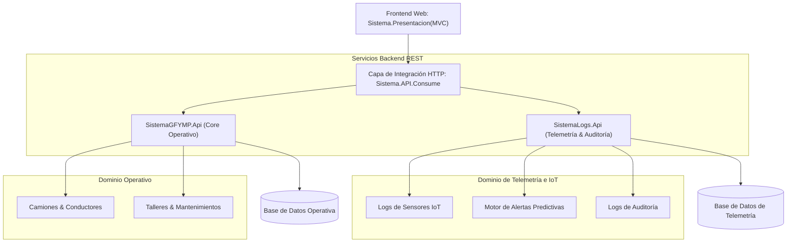

<div align="center">

# 🚛 Sistema de Gestión de Flotas & Mantenimiento Predictivo (GFYMP)

[](https://dotnet.microsoft.com/)
[](https://learn.microsoft.com/dotnet/csharp/)
[](https://dotnet.microsoft.com/)
[](https://learn.microsoft.com/ef/core/)
[](#)

<p align="center">
  Plataforma integral para empresas de transporte y logística basada en una arquitectura orientada a servicios desacoplada, con gestión operativa vehicular y monitoreo continuo mediante telemetría simulada de sensores IoT para detección preventiva de fallas mecánicas.
</p>

</div>

---

## 📌 Tabla de Contenidos
- [Descripción General](#-descripción-general)
- [Arquitectura de la Solución](#-arquitectura-de-la-solución)
- [Módulos del Sistema](#-módulos-del-sistema)
- [Estructura de la Solución (.sln)](#-estructura-de-la-solución-sln)
- [Stack Tecnológico](#-stack-tecnológico)
- [Instalación y Configuración](#-instalación-y-configuración)
- [Autor](#-autor)

---

## 💡 Descripción General

El **Sistema de Gestión de Flotas y Mantenimiento Predictivo (GFYMP)** está diseñado para optimizar el ciclo de vida de flotas de transporte de carga pesada. La solución divide las operaciones comerciales (unidades, conductores, asignaciones de talleres y mantenimientos programados) de la telemetría en tiempo real (sensores de temperatura, presión, vibración y kilometraje), permitiendo disparar **alertas predictivas** antes de que ocurra una avería crítica en ruta.

---

## 🏗️ Arquitectura de la Solución

El sistema implementa una arquitectura desacoplada orientada a servicios (Multi-API) con separación de responsabilidades:



---

## 🚀 Módulos del Sistema

### 1. 🚚 Core Operativo de Flotas (`SistemaGFYMP.Api`)
- **Gestión de Camiones:** Ficha técnica de unidades (marca, modelo, placa, capacidad de carga, odómetro, estado operativo).
- **Control de Conductores:** Asignación de turnos, licencias, certificaciones y registro de infracciones.
- **Mantenimientos Programados:** Calendario preventivo basado en intervalos de kilometraje o tiempo.
- **Red de Talleres:** Registro de convenios mecánicos, presupuestos y órdenes de trabajo.

### 2. 📡 Telemetría IoT & Mantenimiento Predictivo (`SistemaLogs.Api`)
- **Logs de Sensores:** Ingesta de lecturas telemáticas simuladas (temperatura del motor, presión de aceite, desgaste de frenos).
- **Alertas Predictivas:** Algoritmos de umbral que notifican anomalías mecánicas antes de fallos catastróficos.
- **Auditoría de Acciones:** Registro inmutable de eventos y cambios de estado en el sistema.

### 3. 🖥️ Portal Web de Presentación (`Sistema.Presentacion(MVC)`)
- Interfaz gráfica intuitiva con paneles de control, tablas de datos interactivas y formularios de registro para despachadores y jefes de taller.

---

## 📁 Estructura de la Solución (.sln)

```plaintext
Sistema-de-Gestion-de-Flotas/
├── Sistema.sln                              # Solución Visual Studio
├── SistemaGFYMP.Api/                        # Web API de gestión operativa
│   ├── Controllers/                         # Camiones, Conductores, Talleres, Mantenimientos
│   └── Program.cs
├── SistemaLogs.Api/                         # Web API de telemetría y logs
│   ├── Controllers/                         # AlertasPredictivas, LogsSensores, LogsAuditorias
│   └── Program.cs
├── Sistema.Presentacion(MVC)/               # Aplicación cliente web MVC
│   ├── Controllers/                         # Controladores de interfaz de usuario
│   └── Views/                               # Vistas Razor interactivas
├── SistemaGFYMP.Modelos/                    # DTOs y entidades del dominio operativo
├── SistemaLogs.Modelos/                     # Modelos de telemetría y eventos
└── Sistema.API.Consume/                     # Servicios HTTP encapsulados para consumo de APIs
```

---

## 🛠️ Stack Tecnológico

- **Lenguaje:** C# (.NET 8.0 SDK)
- **Servicios:** ASP.NET Core Web API (RESTful endpoints con OpenAPI/Swagger)
- **Presentación:** ASP.NET Core MVC (Razor, Bootstrap, JavaScript)
- **Persistencia:** Entity Framework Core (Code-First)
- **Consumo:** `HttpClientFactory` tipado en capa desacoplada
- **Base de Datos:** SQL Server / Azure SQL

---

## ⚙️ Instalación y Configuración

### Prerrequisitos
- [.NET 8.0 SDK](https://dotnet.microsoft.com/download/dotnet/8.0)
- Visual Studio 2022 o Visual Studio Code
- SQL Server

### Pasos

1. **Clonar el repositorio:**
   ```bash
   git clone https://github.com/JonathanC0409/Sistema-de-Gesti-n-de-Flotas-y-Mantenimiento-Predictivo.git
   cd Sistema-de-Gesti-n-de-Flotas-y-Mantenimiento-Predictivo
   ```

2. **Restaurar y compilar la solución:**
   ```bash
   dotnet restore
   dotnet build
   ```

3. **Ejecutar los servicios en paralelo:**
   ```bash
   # Terminal 1: Iniciar API Operativa (Core)
   dotnet run --project SistemaGFYMP.Api

   # Terminal 2: Iniciar API de Telemetría (Logs)
   dotnet run --project SistemaLogs.Api

   # Terminal 3: Iniciar Frontend MVC
   dotnet run --project "Sistema.Presentacion(MVC)"
   ```

---

## 👨‍💻 Autor

**Jonathan Cepeda**  
- GitHub: [@JonathanC0409](https://github.com/JonathanC0409)  
- Correo: [jjcepedaa@utn.edu.ec](mailto:jjcepedaa@utn.edu.ec)